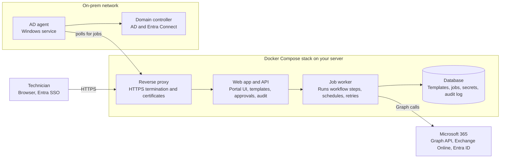

# Rollcall: Product Overview

Last updated: Oct 26, 2026

**Rollcall is a free, open-source (GPLv3), self-hosted portal that turns Microsoft 365 onboarding and offboarding into a few reviewed clicks. Small IT teams manage groups, licenses, Conditional Access, user attributes, MFA, and hybrid on-prem AD from one login, installed with a single command.**

## Summary

Rollcall is a self-hosted web portal that lets a small IT team onboard and offboard staff in Microsoft 365 in a few clicks, instead of a checklist of manual admin-center steps. One technician login covers user creation, groups, licenses, Conditional Access policy membership, user attributes, MFA settings, and, for hybrid shops, the matching on-prem Active Directory changes. It is free and open source under the GPLv3 license, runs on the organization's own server as a Docker Compose stack, and installs with a single script command. One install manages one Microsoft 365 tenant.

This document is the spec developers will use to build an implementation plan. The product is named Rollcall; "the portal" in this document means Rollcall's web portal.

## Problem

Small IT teams spend hours on repetitive onboarding and offboarding work, and the manual steps are where mistakes happen. A typical new hire touches several consoles: the M365 admin center, Entra ID, Exchange, sometimes on-prem Active Directory Users and Computers, plus whatever spreadsheet tracks who gets what.

- **Inconsistent results.** Two technicians onboarding the same role end up with different groups and licenses.
- **Security gaps on exit.** A missed step at offboarding leaves sign-ins, mailbox access, or paid licenses active.
- **License waste.** Licenses stay assigned to departed or misconfigured accounts.
- **No time for review.** Small teams rarely have a second person checking each change, and there is no single record of what was done.
- **Hybrid friction.** Teams still running on-prem AD must make changes in two places and wait for sync.

Existing options are either enterprise identity-governance suites (priced and staffed for large orgs) or home-grown PowerShell scripts that one person understands.

## Target users

The portal is built for internal IT teams of roughly one to ten people supporting an organization on Microsoft 365, cloud-only or hybrid with on-prem AD.

| Persona | What they need from the portal |
| --- | --- |
| IT technician | Run onboardings and offboardings quickly and correctly without memorizing every step |
| IT lead or admin | Define the standard role templates, control who can do what, and see a history of every change |
| Hybrid AD owner | Keep on-prem AD and M365 in step without making each change twice |
| HR or manager (optional, later) | Submit an onboarding or offboarding request for IT to action |

## Core features

Every feature is driven by **role templates**: an admin defines once what a given job (for example "Sales associate" or "Finance manager") gets, and technicians apply the template instead of making each change by hand.

### Onboarding

1. Technician opens a new-hire form: name, department, title, manager, start date, role template.
2. The portal previews every change it will make (account, groups, licenses, policies, MFA) before anything runs.
3. On submit, it creates the account in Entra ID (cloud users) or in on-prem AD (synced users), sets attributes, adds groups, assigns licenses, and sets MFA requirements.
4. It outputs a welcome pack: username, a one-time password or Temporary Access Pass, and first-login steps.
5. Onboardings can be scheduled for the start date.

### Offboarding

1. Technician picks the user and the leave date, or runs it immediately.
2. The portal blocks sign-in, revokes active sessions, resets the password, and removes MFA methods.
3. It removes group memberships and licenses, and records what was removed so it can be reversed.
4. Mailbox handling options: convert to shared mailbox, set forwarding or auto-reply, grant the manager access, hide from the address list.
5. OneDrive handling: grant the manager access for a set period before deletion.
6. In hybrid mode, it disables the AD account and moves it to an Offboarding OU.

### Management features

| Area | What the technician can do |
| --- | --- |
| Groups | Add or remove users from security groups, Microsoft 365 groups, and distribution lists; bulk changes; see who is in what |
| Licenses | Assign and remove licenses, view available seat counts, flag licenses on disabled accounts |
| Conditional Access | View CA policies and manage which users and groups each one includes or excludes, for example a temporary travel exclusion with an expiry |
| User attributes | Edit title, department, manager, office, phone, employee ID, usage location, and custom attributes, singly or in bulk |
| MFA | See each user's registered methods, require re-registration, issue a Temporary Access Pass, and remove lost devices |
| Hybrid AD | Create, update, disable, and move on-prem AD users between OUs, create and manage AD groups (membership and OU placement), and trigger an Entra Connect sync |

### Review and audit

- Every action shows a preview of changes before it runs.
- Optional two-person approval for sensitive actions such as offboarding or CA policy changes.
- A full audit log of who changed what, when, and the result of each step, exportable to CSV.
- Failed steps are shown clearly with a retry button rather than leaving a half-finished user.

## The technician portal

Everything above lives behind one web portal with one sign-in; technicians never need the M365 admin center or ADUC for routine work.

- **Sign-in** with the technician's own Microsoft work account (Entra ID single sign-on), so access follows existing MFA and Conditional Access.
- **Dashboard** showing upcoming onboardings and offboardings, pending approvals, recent failures, and unused licenses.
- **User search** with a single user page: attributes, groups, licenses, MFA methods, CA policies that apply, and change history.
- **Workflows** for onboarding and offboarding, each with a preview step.
- **Templates and settings** area for admins: role templates, approval rules, tenant and AD connection settings.
- **Roles inside the portal**: Technician (run workflows), Approver, and Admin (templates, settings, CA changes).

## Architecture

The portal is a small set of containers on one host; it reaches Microsoft 365 through Microsoft Graph and reaches on-prem AD through a lightweight agent installed inside the customer's network.



Outbound HTTPS only: the worker calls Microsoft and the AD agent polls the portal for jobs.

- **Reverse proxy** handles HTTPS and certificates, for example Caddy or Traefik.
- **Web app and API** serve the portal, handle technician sign-in, and queue work as jobs.
- **Job worker** runs each workflow step against Graph, Exchange Online, or the AD agent, with retries and scheduled starts.
- **Database** (for example PostgreSQL) stores templates, job history, encrypted secrets, and the audit log.
- **AD agent** is a small Windows service on a domain-joined server. It polls the portal for AD jobs, runs them as a group managed service account (gMSA), so no AD password is ever entered into the portal, and can trigger an Entra Connect delta sync so cloud steps such as license assignment can follow.

For synced (hybrid) users, attributes like name and department are mastered in AD, so the portal writes those through the agent and only writes cloud-only settings, such as licenses and MFA, through Graph.

## Deployment and installation

The portal installs on a single Linux host with one command and is running in the browser minutes later.

```bash
curl -fsSL https://<download-host>/install.sh | sudo bash
```

The install script:

1. Checks the host and installs Docker Engine and the Compose plugin if they are missing.
2. Asks for the portal's hostname and whether to use Let's Encrypt or a supplied certificate.
3. Generates the database password, encryption key, and other secrets into a protected `.env` file.
4. Writes `docker-compose.yml`, pulls the images, and starts the stack.
5. Prints the portal URL, where a setup wizard finishes the job in the browser.

The setup wizard registers an Entra ID app for the tenant (the admin uploads the certificate the portal generates, then grants admin consent), connects the first admin account, and optionally generates an install command for the on-prem AD agent.

- **Updates:** the same script with an `update` flag pulls new images and runs database migrations.
- **Backups:** a `backup` command dumps the database and configuration to a single archive.
- **Host requirements:** a Linux VM or server with outbound HTTPS to Microsoft Graph. CPU, memory, and supported distributions are still to be set.

## Security and permissions

The portal holds standing admin rights over the tenant, so it is designed to be the most tightly locked part of the IT estate.

- **No stored user credentials.** The portal never stores an M365 or AD admin username and password. It acts through an Entra app registration, and technicians sign in as themselves with Entra single sign-on, so every action is logged under their name.
- **App credential: certificate only.** The portal generates a key pair at setup and shows the public certificate to upload to the app registration. The private key never leaves the server. Client secrets are not supported, because Microsoft documents app-only Exchange Online access with certificates, and mailbox conversion is required in v1.
- **Certificate lifecycle.** The portal tracks the certificate's expiry, warns admins 30 days ahead, and offers a guided rotation: generate a new certificate, upload it alongside the old one, then retire the old one.
- **Least privilege.** Each feature requests only the permissions it needs (table below). Features can be switched off to drop their permission.
- **Directory roles.** Some actions need a directory role on the app's service principal as well as a Graph permission, for example Exchange Administrator for mailbox actions and an authentication or user admin role to reset passwords and MFA. The exact role per action is for developers to confirm.
- **Portal roles** limit which technicians can make high-impact changes such as CA policy edits.
- **Secrets at rest.** The certificate private key and AD agent keys are encrypted in the database with a key generated at install.
- **AD agent** connects outbound only over HTTPS, so no inbound firewall ports are opened to the domain controller network.
- **Audit log** is append-only from inside the portal.

### Microsoft Graph application permissions by feature

These are a starting point for developers to verify against current Microsoft documentation.

| Feature | Permissions |
| --- | --- |
| Read users, groups, tenant | User.Read.All, Group.Read.All, Organization.Read.All |
| Create and update users, attributes | User.ReadWrite.All |
| Reset passwords | User-PasswordProfile.ReadWrite.All (plus a directory role) |
| Revoke sessions, block sign-in | User.RevokeSessions.All, User.EnableDisableAccount.All |
| Group membership | GroupMember.ReadWrite.All (distribution lists go through Exchange Online) |
| Licenses | LicenseAssignment.ReadWrite.All |
| Conditional Access | Policy.Read.All, Policy.ReadWrite.ConditionalAccess |
| MFA methods and Temporary Access Pass | UserAuthenticationMethod.ReadWrite.All |
| Mailbox actions | Exchange.ManageAsApp (Office 365 Exchange Online API) plus Exchange Administrator role |
| OneDrive handover | Sites.FullControl.All, or a narrower Sites.Selected setup |
| Audit of sign-ins (optional) | AuditLog.Read.All |

## Documentation and day-1 guides

Full documentation and step-by-step day-1 deployment guides are a v1 release requirement: a release is not done until its docs are. Docs live in the same repository as the code, are versioned with each release, and are linked from a Help menu in the portal.

### Documentation set

| Document | Reader | Covers |
| --- | --- | --- |
| Day-1 deployment guide | Admin installing the portal | Every step from an empty server to a first test onboarding (below) |
| Administrator guide | IT lead or admin | Role templates, approval rules, portal roles, certificate rotation, AD agent, updates, backups and restore |
| Technician guide | IT technician | Onboarding, offboarding, and each management feature, with screenshots |
| Permissions reference | Admin, security reviewer | Every Graph permission and directory role, which feature needs it, and what turning a feature off removes |
| Troubleshooting guide | Admin, technician | Common errors (consent, certificate, sync delay, agent offline) with fixes |
| Developer and contributor guide | Open-source contributors | Local dev setup, architecture, GPLv3 licensing, the contributor license agreement (CLA) and contribution terms, coding standards, how to add a workflow step, release process |
| Release notes | Everyone | Changes, upgrade steps, and breaking changes per version |

### Day-1 deployment guide steps

The guide walks one admin through the whole first day as numbered steps, each with the exact command or screen, the expected result, and how to check it worked.

1. **Prerequisites checklist:** Linux host, DNS name, outbound HTTPS, a Global Administrator for consent, and for hybrid a domain-joined Windows server for the agent.
2. **Run the install command** and confirm the portal loads over HTTPS.
3. **Create the Entra app registration:** upload the portal-generated certificate, add the permissions, and grant admin consent.
4. **Assign directory roles** to the app's service principal, such as Exchange Administrator.
5. **Sign in as the first admin** with Entra SSO and set portal roles for the team.
6. **Hybrid only: install the AD agent** as a gMSA, delegate rights on the target OUs, and confirm the agent shows as connected.
7. **Build the first role template** from a real job in the organization.
8. **Run a test onboarding and offboarding** on a pilot user and check the audit log.
9. **Set up and test backups,** including one restore.
10. **Go-live checklist** to confirm everything above before technicians start using it.

Each step should be testable by someone who has never seen the product. Developers should plan time for writing docs and for a walkthrough of the day-1 guide on a clean server before each release.

## Scope and open questions

Version 1 covers identity lifecycle for one M365 tenant per install, plus on-prem AD users, groups, and the OUs they sit in. Device management, HR-system integration, and Exchange on-prem are out of scope for now. The core product is free and open source under the GNU General Public License v3 (GPLv3) and keeps the v1 scope for small internal IT teams. Rollcall follows an open-core model: paid MSP and multitenant editions may follow later, built on the same core. Contributors sign a contributor license agreement (CLA) so the project can offer those editions. The repository ships a LICENSE file, and every bundled dependency and container image must have a GPLv3-compatible license.

**Not in version 1**

- Intune device wipe or enrollment
- Automatic triggers from an HR system (Workday, BambooHR, and similar)
- Multi-tenant management (a second tenant needs a second install); planned as a paid MSP edition
- Exchange on-prem (Exchange Server) management
- A hosted SaaS version

**Decisions**

- [x] What is the product name? Rollcall.
- [x] Who is this document for? Developers, as the spec for an implementation plan.
- [x] How does the portal authenticate to M365? Entra app registration with a certificate only; no client secrets and no stored admin credentials.
- [x] Is this a commercial product, open source, or an internal tool for one organization? Open core. The core is free and open source under GPLv3 and ships v1 for small teams; MSP and multitenant editions will be paid (decided Oct 26, 2026).
- [x] Should a single install manage one tenant only, or several? One install manages one tenant. Multitenancy is not built in; a second tenant means a second install.
- [x] Which on-prem actions matter most for hybrid? Managing AD users, groups, and the OUs they sit in is in scope; Exchange on-prem is out of scope.
